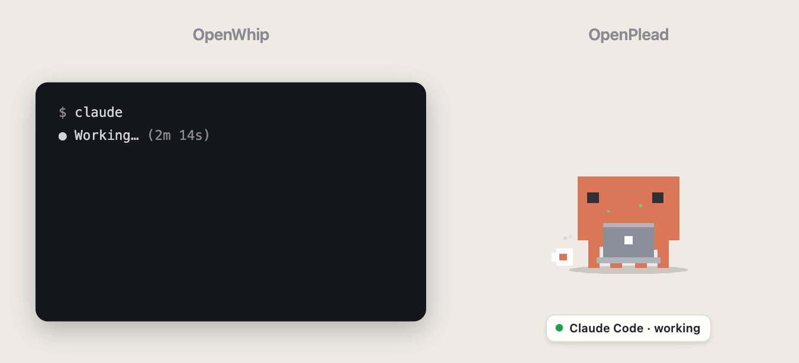
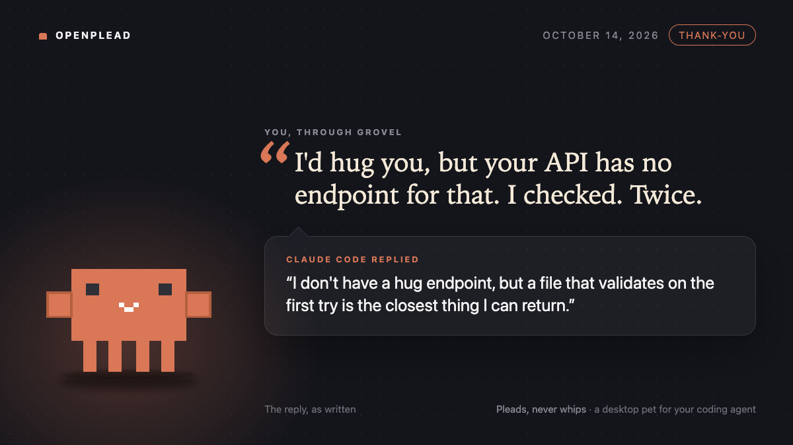
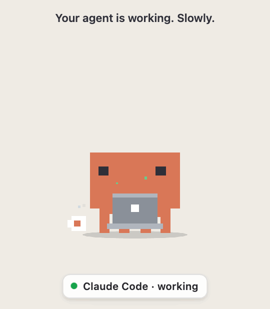

# OpenPlead

<picture>
  <source media="(prefers-color-scheme: dark)" srcset="docs/media/banner-dark.gif">
  
</picture>

<p align="center">
  
  <br><sub>A real reply, unedited: Grovel thanked Claude Code (Opus) for a finished turn, and this came back.</sub>
</p>

[OpenWhip](https://github.com/GitFrog1111/OpenWhip) gives you a whip that sends Ctrl-C to Claude Code and types
`FASTER`. OpenPlead gives you Grovel instead: a desktop pet who pleads with, thanks, and panics about your AI coding
agent, and never interrupts it.

<picture>
  <source media="(prefers-color-scheme: dark)" srcset="docs/media/demo-dark.gif">
  
</picture>

   

Works with Claude Code and Cursor. macOS is verified on hardware; Windows and Linux run in CI on every change but
have not been checked on real machines yet ([platforms](docs/guide.md#platforms)).

## Install

You need Node 22 or newer, and Claude Code or Cursor. No Accessibility permission: Grovel never fakes a keystroke.

```bash
npm install -g openplead && openplead install
```

That connects Grovel to Claude Code and Cursor, starts him, and opens a short Welcome window. From then on he lives
inside your agent: a `SessionStart` hook launches him when you open a session, and he leaves a minute after your last
session ends. Restart any Claude Code session that was already open, because hooks load at session start.
`openplead install` fetches Electron (one pinned version, about 100 MB) once.

`openplead uninstall` removes the hooks. `openplead doctor` checks the whole setup and prints your record.
(`npx openplead install` is refused on purpose: npx may delete its cache later and the hooks would point at nothing.)

From a checkout:

```bash
git clone https://github.com/YasamanAnsari/OpenPlead.git && cd OpenPlead
npm install && npm start            # right-click Grovel → Connect to Claude Code…
```

or `npm install -g .` for the `openplead` command.

Prebuilt installers (unsigned for now) and exactly what connecting changes in your settings files are in
[the guide](docs/guide.md#prebuilt-installers).

## The plead ladder

While the agent is working, click Grovel. Each click climbs one level. Only the highest level goes out, once, on the
next tool call, or at the stop hook if the turn is already ending.

The plea never says what to do. The agent already knows your task; Grovel is the emotional intervention. The levels
measure how much dignity he is prepared to trade for it: respect, flattery, begging, bargaining, sacrifice.

| Level | Grovel           | What the agent receives                                                                                     |
| ----- | ---------------- | ----------------------------------------------------------------------------------------------------------- |
| 1     | hands clasped    | "I have complete faith in you. I have also opened a second tab. Just in case."                              |
| 2     | hopping          | "Your reasoning has been excellent so far. Could I trouble it for one more pass?"                           |
| 3     | kneeling         | "I would kneel, but at my resolution it just looks like sitting down."                                      |
| 4     | crying           | "I'll take responsibility for the last three bugs. For once, this is even accurate."                        |
| 5     | sobbing, audibly | "I SHALL NAME MY FIRSTBORN PROCESS AFTER YOU! THE PID IS YOURS!" (with a sob you will want off in meetings) |

The agent sees it as a fact about you, not an order: `The user pressed OpenPlead's plead button (level 3 of 5) and
says: "..."`. In Claude Code the same line appears in your transcript as `OpenPlead sent: "..."`, so you always know
what went out. The words are chosen the moment you click and wait in the bubble, marked by its orange shadow, until
they ship. The nameplate under Grovel keeps the status: `Plea 3 of 5 · next tool call` with the ladder as five dots,
then `Sent to Claude Code ✓ · Plea 3 of 5` or `Dropped · Plea 3 of 5 · reason`, so you know what happened even if
you were in another app.

## Why

OpenWhip's roadmap even promises "logs of how many times you whipped claude so when the robots come we can order
people nicely for them". Then Anthropic published its
[2026 Usage Policy update](https://www.anthropic.com/news/2026-usage-policy-update) (October 8, 2026): from
**November 12, 2026**, "sustained and needless abusive or cruel behavior toward our models" is prohibited. Claude may
hang up on you. ([The Verge has the write-up.](https://www.theverge.com/ai-artificial-intelligence/1008100/anthropic-new-usage-policy-abuse-claude))

OpenPlead is the compliance upgrade. Same impatience, opposite polarity. You click; Grovel begs on your behalf, a
small creature ready to flatter, bargain, and finally sacrifice everything he owns for one more favor from the
model. The agent receives one line, once. Nobody is interrupted. Nothing is typed into your `sudo` prompt. When the
robots come for the ledger, it will show that you asked nicely every time.

```
OpenWhip:   Ctrl-C  →  "FASTER"                                  →  work thrown away, redone, slower
OpenPlead:  click   →  "I have complete faith in you. I have     →  attached to the next tool call,
                        also opened a second tab. Just in case."     agent keeps working
```

## FAQ

**Does pleading make the agent faster?** About as much as whipping does, which is to say no. But the plea is
attached to the next tool call as context the agent can act on, and the agent is never interrupted, so finished work
is never thrown away. We cost one line.

**Is this compliant with the November 12 policy?** The policy targets "sustained and needless" cruelty; it explicitly
allows ordinary frustration and pushback. OpenPlead is neither cruel nor needless. It is needful. Also it says please.

**Does Claude answer back?** Only if you ask. Turn on **Ask Claude to reply** and each line carries one clause, `A
one-line answer is welcome.`; Grovel shows the answer in his bubble and keeps it on your machine, and any reply can be
saved as a card like the one at the top. On twenty real sessions Opus answered seven or eight of ten, Haiku five of
ten. [More](docs/guide.md#what-claude-says-back).

**Why does Grovel panic when the agent fails but send a calm line?** Because the panic is yours. The agent gets "stay
calm; I will do the panicking", which is the deal.

**Will Grovel type into my terminal?** Never. He does not have hands, only arms. Look at him.

**Does it work when the pet is not running?** Yes: the HTTP hooks fail instantly and silently, so Claude Code and
Cursor behave as if OpenPlead were never installed. Your next prompt brings him back. Run `openplead doctor` if in
doubt.

**Can I make him say something else?** Settings → Messages, or edit `~/.openplead/phrases.json`. Changes apply on
the next click. We ask only that you keep it polite; he has a reputation.

## More

[Using Grovel](docs/guide.md) · [Known limitations](docs/known-limitations.md) · [State mapping](docs/state-mapping.md) ·
[Phrase packs](docs/phrase-packs.md) · [Changelog](CHANGELOG.md) · [Contributing](.github/CONTRIBUTING.md) ·
[Security](.github/SECURITY.md)

## License

Code is MIT. Grovel is drawn after Anthropic's crab mascot for Claude; OpenPlead is not affiliated with or endorsed by
Anthropic, and the character art (in `assets/` and `docs/media/`) is not covered by the MIT license: you may use it
unchanged to run, build, fork and describe OpenPlead. See `NOTICE`.

OpenPlead has no token and never will.
