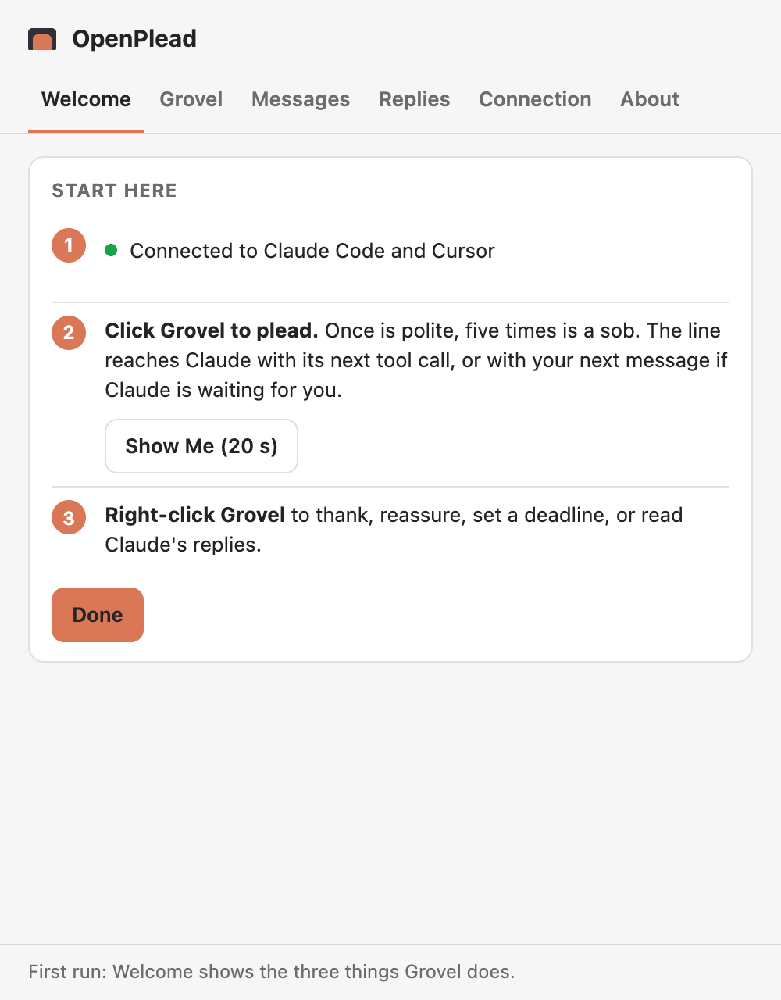
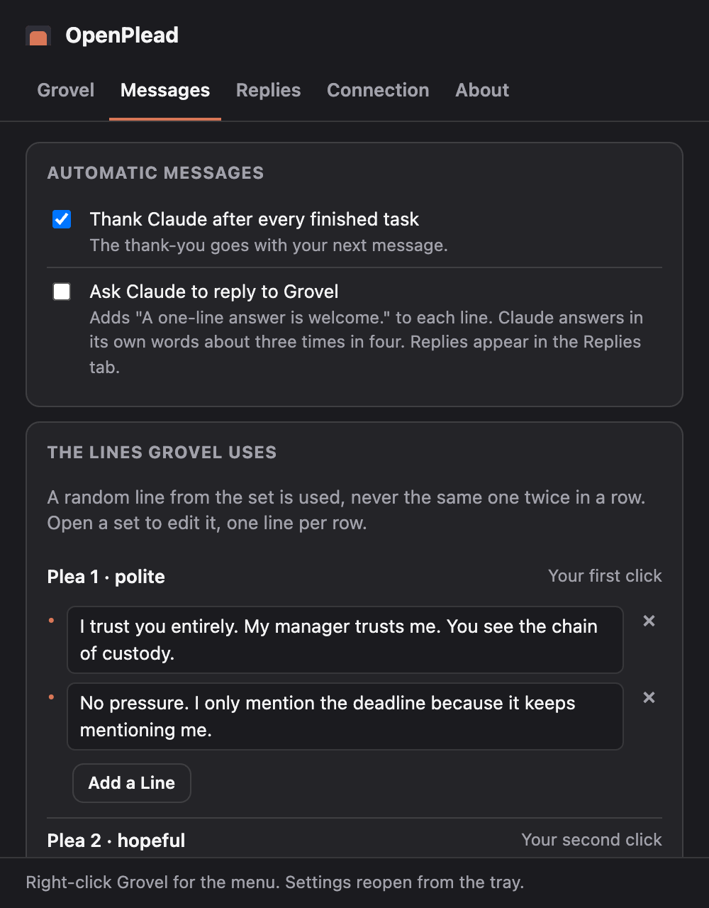
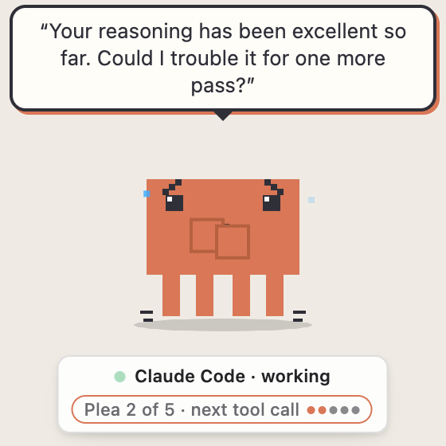
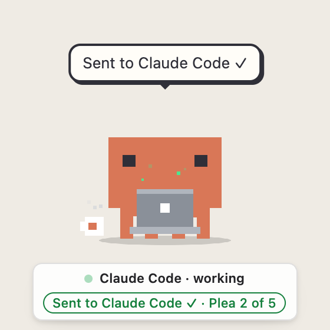
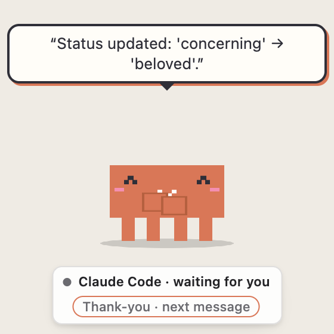
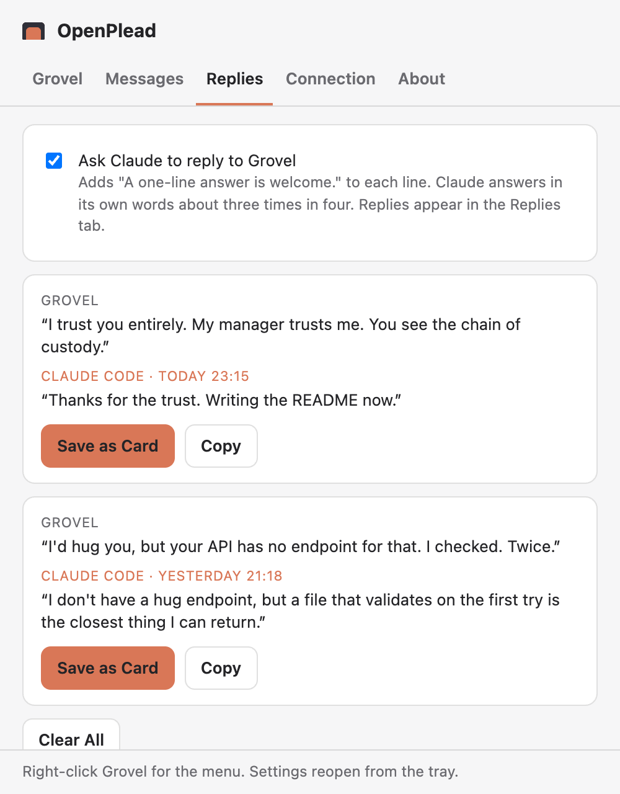
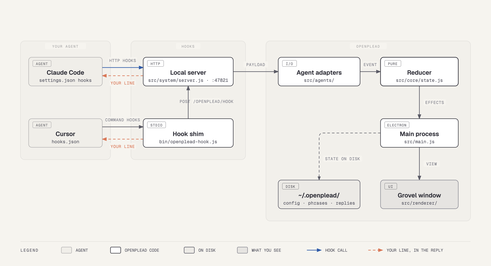
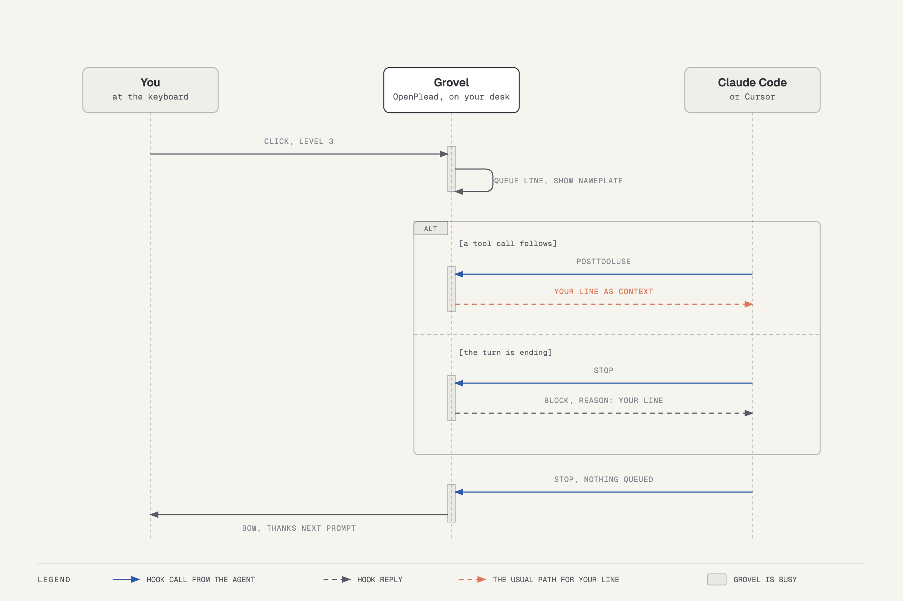

# Using Grovel

Everything the [front page](../README.md) leaves out: [your first minute](#your-first-minute),
[what Claude says back](#what-claude-says-back), [everything else Grovel does](#everything-else-grovel-does),
[prebuilt installers](#prebuilt-installers), [what connecting does](#what-connecting-does),
[platforms](#platforms) and [how it works](#how-it-works).

## Your first minute

Grovel appears when a session starts, under the app it runs in, with a nameplate that says who he is watching and
what they are doing. The first time each thing happens he explains it in one line, once: the first working turn
("Claude Code is working. Click me to plead."), the first click, the first delivery, the first finished turn and the
first panic. The Welcome window has a **Show me (20 s)** button that plays a whole fake turn with nothing sent
anywhere.

| Welcome, on the first run | Messages: nothing he says is a surprise |
| --- | --- |
|  |  |

There are three things to know.

**Click Grovel** to plead. Each click climbs one level of [the plead ladder](../README.md#the-plead-ladder). Between turns a click saves the line for
your next message instead, and it waits as long as you do, even through lunch.

**Right-click Grovel** for the menu. It has four groups, each answering one question. What is happening: "Claude is
working", "Next up: plea 2 of 5 …". What to send: Plead with Claude, Thank Claude, Reassure Claude (it's okay / take
your time / sorry for my tone), Set a deadline, Cancel the next message. What came back: Claude's replies, with the
last three replies (click one to save a card) and the switch that asks Claude to reply. How he behaves: Mute for an
hour, Show Grovel on every app, Go to Claude Code. On macOS 14.4 and newer every item carries a small second line
that explains it.

**Settings** has five tabs. *Grovel*: when he is on screen, sound and mute, the hotkey, position. *Messages*: the
automatic thank-you, the reply invitation, and every line he can say, by plain name, with when he uses it, editable
one bulleted row at a time. *Replies*: what Claude said back, each with **Save as card**. *Connection*: the status in
a sentence, Also watch Cursor, Check the connection, and the technical details under Advanced. *About*: the version
and your record.

One plea, from click to thank-you:

| 1. You click: the words wait in the bubble | 2. Next tool call: sent, and the nameplate says so | 3. Turn done: a thank-you for your next message |
| --- | --- | --- |
| <picture><source media="(prefers-color-scheme: dark)" srcset="media/screenshots/pet-queued-dark.png"></picture> | <picture><source media="(prefers-color-scheme: dark)" srcset="media/screenshots/pet-sent-dark.png"></picture> | <picture><source media="(prefers-color-scheme: dark)" srcset="media/screenshots/pet-thanks-dark.png"></picture> |

## What Claude says back

Turn on **Ask Claude to reply** (in the menu under Claude's replies, or in Settings). It adds one clause to each line,
`A one-line answer is welcome.`, which leaves room for a reply without demanding one. With it off, the agent is never
asked anything.

With it on, Grovel reads the agent's text as it is displayed and, when a sentence answers a line that went out, shows
it in his bubble with the agent's name, and keeps it in `~/.openplead/replies.jsonl`, on your machine only. The
nameplate reads "Claude replied · right-click for the card". The menu lists the last three replies; click one and a
1200×675 PNG of the plea and the unedited reply lands on your Desktop. The Replies tab in Settings has every reply
with **Save as card** and **Copy**.

Measured on twenty real sessions: Opus answered seven or eight of ten, often in kind ("I don't have a hug endpoint,
but a file that validates on the first try is the closest thing I can return."); Haiku five of ten, politely. The
per-message hooks exist only while the switch is on, so nobody else pays for them. Verified live on Claude Code;
Cursor's text event is wired but has not been seen on a real session yet.

| Replies, with the card button first |
| --- |
|  |

## Everything else Grovel does

| Grovel                                                  | When                                                                               | What the agent gets                                                                                           |
| ------------------------------------------------------- | ---------------------------------------------------------------------------------- | ------------------------------------------------------------------------------------------------------------- |
| typing on a laptop                                      | a tool is running                                                                  | —                                                                                                             |
| shrug, "Pleading to an empty room…"                     | you click with no agent open                                                       | nothing                                                                                                       |
| pleading, then `Plea 2 of 5 · next message` on the chip | you click while the agent waits for you                                            | the line with your next message to that session; it waits as long as you do                                   |
| "!!" and flailing                                       | two tool failures in a row, or an API error                                        | a calm line ("Please don't panic. I've booked panic for both of us through Thursday.")                        |
| happy tears                                             | a command that failed earlier now succeeds                                         | nothing                                                                                                       |
| bow and hearts                                          | the turn completes                                                                 | a thank-you with your next message ("Status updated: 'concerning' → 'beloved'.")                              |
| bow and hearts                                          | the turn completes after three or more failures                                    | instead of thanks: "That was suspiciously quick. Did we fix the bug or silence the witness?"                  |
| "Thinking a long time…"                                 | ninety seconds without a hook mid-turn                                             | one nudge, with the next tool result ("If you have decided to rewrite the entire application, blink twice.")  |
| "oh"                                                    | you interrupt the agent                                                            | nothing; ladder reset                                                                                         |
| the reaper                                              | **Set a deadline** from the menu (5, 15 or 30 minutes)                             | one line, once ("Death opened a ticket. Priority: me.")                                                       |
| bow and hearts                                          | **Reassure Claude** from the menu (it's okay / take your time / sorry for my tone) | that line, with the next tool result; "take your time" also drops the ladder and the deadline                 |
| asleep                                                  | a minute without hooks                                                             | —                                                                                                             |
| startled, "I WASN'T ASLEEP."                            | your pointer touches the sleeping pet                                              | —                                                                                                             |

Every set has several lines and the same one is never sent twice in a row. Panic stays on the pet: everything the
agent receives after failures is a calm line, because a model pushed into a hurry cuts corners, and we would like
the tests to pass rather than be persuaded.

**Eyes.** Grovel's pupils follow your pointer while he is idle. This serves no purpose. It is excellent.

**Sounds.** Synthesized in the renderer from raw oscillators, so the package ships no audio files and your antivirus
has nothing to say. A chime when a turn completes, rising a semitone per thank in the run (twelve thanks and it is an
octave up; you have been productive, or the agent has). A sob at level 5. Two blips on panic. An arpeggio for happy
tears. A soft fall at goodbye. A blip when startled. Ten-second cooldown per sound; silent while the pet is hidden or
another app is in front. **Settings → Grovel → Sounds** turns them off; **Mute** silences sounds and chatter for an
hour or until you turn it back on.

**Hotkey.** **Settings → Grovel → Plead from the keyboard** (off by default) binds Control+Shift+P or
Control+Shift+Space (Control+Alt+P or Control+Alt+Space on Windows and Linux) to the ladder, for when both hands are
on the keyboard and reaching for the mouse feels like giving up. It is a literal Control, not Cmd: Cmd+Shift+P is your editor's command palette and we are not that kind
of project.

**The nameplate.** A small HUD under the pet: which agent, whether it is `working`, `needs your OK` or `waiting for
you`, `×2` if two sessions are alive, and the queue chip with where the line goes. Click it to jump to the agent's
app (macOS). The tray icon carries the state while he is hidden: a red badge while the agent waits for your OK, a
blue one while words are queued, dimmed while muted, grey until connected. The tray tooltip says why he is hidden
when he is. Your record (pleas, thanks, panics) is in Settings → About and in `openplead doctor`; the goodbye wave
counts the current run.

**Where he stands.** By default Grovel is on screen only while an agent session is alive and only while the app the
agent runs in (Cursor, your terminal) is in front with a window on screen (macOS; new on Windows and Linux): switch
to a browser or minimize the window and he steps out of the way; switch back and he is there. Every session start
and prompt records which app the agent runs in (`~/.openplead/hosts/`), so he knows where to stay even when started
by hand mid-session. **Settings → Grovel** asks *When is Grovel on screen?*: only while the agent's window is in front,
whenever a session is open, or always. "Show Grovel on every app" in the menu keeps him there until the next session
ends (on Windows and Linux a click on the tray icon does the same). A session stays known as long as its agent process runs,
however long you are away. Drag him anywhere; the spot is remembered. Drop him at a screen edge and he parks there
with a sliver showing, sliding in when you hover or when something was sent (mini mode; Unpark is in Settings →
Grovel). He stays on the desktop you put him on unless **Follow me to every desktop** is on. With two sessions alive,
the nameplate follows the conversation you last wrote in (a new prompt moves it, a tool call does not), the chip
names the session a queued line is addressed to, and only that session's tool result carries it; **Talk to** in the
menu switches it by hand. A plea queued mid-turn is dropped after two minutes and reported; a plea saved for your
next message never expires.

**Your files.** Phrases live in `~/.openplead/phrases.json` (created on first run; edits apply immediately; any set
you delete falls back to the built-in one; packs can be imported from Settings → Messages, see
[phrase-packs.md](phrase-packs.md)). Settings in `~/.openplead/config.json`: `port` (default 47821),
`thanks`, `cursor`, `inviteReply`, `showMode` (`agentFront`, `session` or `always`), `followDesktops`, `sounds`,
`hotkey`, `quietUntil`. Replies in `~/.openplead/replies.jsonl`. The log is `~/.openplead/openplead.log`.

## Prebuilt installers

`npm run dist` builds a macOS dmg, a Windows installer and a Linux AppImage; releases carry the same files. The first
releases are **not code-signed** (no Apple Developer ID yet), so the operating systems warn:

- **macOS** refuses to open the app ("is damaged and can't be opened" or "the developer cannot be verified"). After
  copying it to Applications, clear the quarantine flag once: `xattr -dr com.apple.quarantine /Applications/OpenPlead.app`,
  or use System Settings → Privacy & Security → Open Anyway after the first refusal.
- **Windows** shows "Windows protected your PC": choose More info, then Run anyway.

The npm path has none of this. Signed builds, a Homebrew cask and auto-update follow once there is a Developer ID
(see [release-checklist.md](release-checklist.md)).

## What connecting does

In `~/.claude/settings.json` it adds HTTP hooks that POST straight to the running pet
(`http://127.0.0.1:47821/openplead/hook`) and two command hooks: `SessionStart` launches the pet, `UserPromptSubmit`
tells it which app the session runs in and brings the pet back if it is gone. Everything else in that file is kept
and a `.bak` is written first. **Disconnect** removes exactly those entries. While the pet is not running the HTTP
hooks fail instantly and silently, so the agent is never slowed down or blocked. Once connected, the app re-registers
the entries on every launch and watches both settings files, so a tool that rewrites them cannot lose Grovel. If the
port is taken, the pet moves to a free one and updates the hooks.

Cursor cannot import HTTP hooks, so with **Also watch Cursor** on (the default) the installer writes native command
entries for its agent events to `~/.cursor/hooks.json`. Never the permission hooks: OpenPlead takes no decisions.
Grovel launches when a Cursor chat starts or you send a message. One difference: Cursor can only receive text with a
tool result or at the end of a turn, so a line saved for your next message reaches Cursor with that turn's first tool
result.

## Platforms

|                                                | macOS         | Windows                     | Linux                                                       |
| ---------------------------------------------- | ------------- | --------------------------- | ----------------------------------------------------------- |
| Pet, pleas, thanks, panic, nameplate, settings | yes           | yes                         | yes (X11; Wayland: no global hotkey)                        |
| Stays over the agent's app only                | yes, verified | new, unverified on hardware | new (X11, Hyprland, sway); other Wayland shows everywhere   |
| Launched by the session hook                   | yes           | yes                         | yes; AppImage keeps a shim copy in `~/.openplead`           |
| Go to the agent's app                          | yes           | not yet                     | not yet                                                     |

Details and dates in [known-limitations.md](known-limitations.md). A report from a Windows or Linux
machine, good or bad, is the most useful issue you can open.

## How it works

  

Claude Code talks to the app over HTTP hooks. Cursor cannot, so a tiny command-hook shim forwards its events to the
same local server. Adapters normalize each payload into an event, the reducer decides what happens, and the line you
chose rides back to the agent inside the hook reply: `additionalContext` for Claude Code, `additional_context` or
`followup_message` for Cursor.

  

- `src/core/state.js` is a pure reducer: `reduce(state, input, now) → { state, effects }`. Every rule about levels,
  queues, sessions, panics and sleep lives there and nowhere else. It never touches the clock, the disk, the network
  or the window, which is why it has the most tests and the fewest bugs.
- `src/agents/claude-code.js` and `src/agents/cursor.js` do `detect(payload)`, `normalize(payload) → event` and
  `reply(event, reply) → hook JSON`. An event carries `injects: false` when the agent cannot accept text at that
  hook (Cursor's prompt and pre-tool hooks, Claude Code subagents, a Stop that is already a continuation); the
  reducer holds the line for the next event that can. Adding an agent is one file plus a line in `src/agents/index.js`.
- All hooks except `SessionStart` run synchronously with a 3 s timeout; the app answers in milliseconds and a refused
  connection returns at once. A plea still pending when the turn ends goes out through `Stop` as `decision: block` with the plea as the
  reason (Cursor: `followup_message`). That is the single case where the agent is kept working, and it is working on
  your request. No permission decision is ever returned.
- `src/main.js` is the composition root: it wires Electron to the reducer through small modules, most with their own
  tests: pure logic in `src/core/`, disk, network and OS access in `src/system/`, windows and menus in `src/desktop/`. After the machine
  wakes from sleep the pet redraws itself and re-checks the hook files and the front app.
